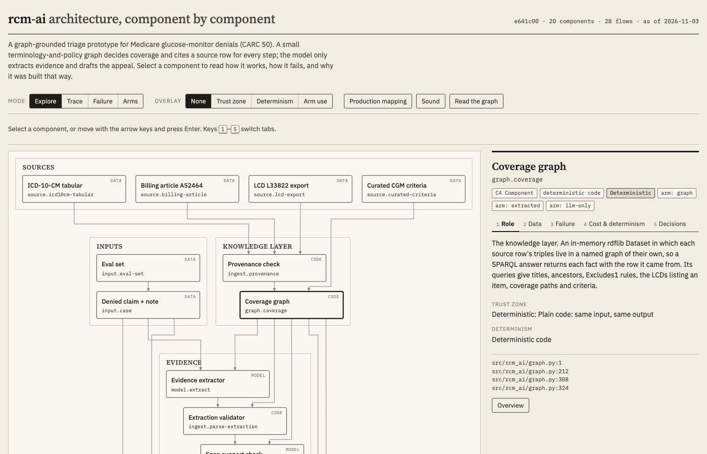

# rcm-ai

Exploratory prototype: graph-grounded triage of Medicare medical-necessity denials. Synthetic data only.

**The eval labels are unconfirmed.** Claude drafted all 20 eval cases and labeled them, and no human has reviewed a label yet (#15). Every accuracy number below is agreement with those labels; a corrected label changes it.

## Architecture explorer

[](https://jagnyesh.github.io/rcm-ai/architecture/rcm-ai-explorer.html)

[Open the interactive explorer](https://jagnyesh.github.io/rcm-ai/architecture/rcm-ai-explorer.html): each component's role, data, failure modes and design decisions, with the source lines behind it, and modes that trace a case, show failures and compare the arms. The page is [docs/architecture/rcm-ai-explorer.html](docs/architecture/rcm-ai-explorer.html); it reflects `e641c00`.

## Quickstart

You need [uv](https://docs.astral.sh/uv/), which installs Python 3.13 if you don't have it. From a clone:

```bash
uv run rcm-ai demo
```

It makes no model call and needs no API key. For three eval cases, one per verdict, it prints the claim, the note, the evidence spans, the verdict, and each step behind the verdict with the source row it rests on: the fixture file and line, the source version, and the text to look for there. Read each case's first line, the verdict, then its numbered steps or its reason. For the overturnable case it also prints an appeal letter recorded in the 2026-11-01 run, not drafted now, and checks the letter's citations against the verdict; a letter that fails the check makes the demo exit 4.

| Command | Model calls |
|---|---|
| `uv run rcm-ai demo` | none |
| `uv run rcm-ai triage <case>` | none |
| `uv run rcm-ai eval` (graph arm only) | none |
| `uv run rcm-ai ingest` | none |
| `uv run rcm-ai stats <run record>... [--seed N]` | none: reports each arm's accuracy across run records of one commit, eval set and configuration, read as repeats, and compares each pair of arms: McNemar's exact test per repeat and the accuracy difference with a 95% bootstrap interval over cases; with three arms, Cochran's Q per repeat |
| `uv run rcm-ai triage <case> --extract` | at most 2: an extraction, then a support check if it validates |
| `uv run rcm-ai triage <case> --draft` | 1 for an overturnable verdict |
| `uv run rcm-ai eval --arms graph,extracted,llm-only` | 35 in the 2026-11-01 run: an extraction for each claim not decided by the claim alone, and a baseline verdict for every claim. The support check (#22) now adds one per extraction that validates: 13 on 2026-11-02 |
| `uv run rcm-ai eval --arms graph,extracted,llm-only --draft` | 61 in the 2026-11-01 run: the above plus a draft for each overturnable verdict of each arm |

Commands that call the model need Anthropic API credentials, such as `ANTHROPIC_API_KEY`. The eval's metrics are defined in [data/eval/README.md](data/eval/README.md). Run the tests with `uv run pytest -q`; they take about two minutes and skip the 26 live tests without credentials.

## Problem

A denial analyst working a medical-necessity denial (CARC 50) must decide whether the documented diagnosis supports the billed item under the governing coverage policy, which means cross-referencing the note, the claim's ICD-10-CM and HCPCS codes, the ICD-10-CM hierarchy and Excludes1 rules, and the LCD's billing article. 
An LLM can draft an appeal, but it decides coverage from memory and cites policy it can't trace. 
This prototype lets a small terminology-and-policy graph make the coverage decision and return a justification path where every hop points at a row in a public source file. 
The LLM extracts evidence from the note and drafts the appeal, and a deterministic checker fails any letter that cites a code or policy ID the justification path doesn't establish. 
An eval set of 20 labeled synthetic cases scores the graph on supplied evidence and on LLM-extracted evidence against an LLM-only baseline, on verdicts and on the citations in their appeals, so the value of the knowledge layer is measured, not asserted. 
The labels are Claude's best judgment and await human review (#15).

## The knowledge layer

Here the knowledge layer means the graph and the rules that decide coverage from it, as opposed to what a language model knows. The graph is built from public source files, and every fact in it keeps a pointer to the row it came from.

**What's in it.** It is one RDF dataset (rdflib), built at startup by `build_graph` in `src/rcm_ai/graph.py` from the pinned fixtures and the curated criteria:
- **ICD-10-CM codes**, from the CDC tabular: each code's title, its parent code (`skos:broader`), its Excludes1 notes, and seventh-character codes expanded from `sevenChrDef`.
- **The LCD**, from the CMS LCD export: the HCPCS items it lists (`listsHcpcs`) and its link to the billing article, with the article version that link cites.
- **The billing article**: the covered diagnosis codes (`coversDiagnosis`).
- **The coverage criteria**, from `data/curated/`: each is a verbatim quote from the LCD, with how criteria nest (`anyOf`) and which one the diagnosis code itself satisfies.

**Provenance.** Each source row's triples go in a named graph of their own, whose metadata holds the file, version and line. A SPARQL answer therefore returns each fact together with the row it rests on, so every step of a justification path can print `file:line [version]`.

**What decides.** `adjudicate` in `src/rcm_ai/adjudicate.py` is plain code with no model call. It takes a claim (HCPCS item, billed ICD-10-CM codes, CARC, initial or continued coverage) and evidence (the codes and criteria the note documents, each with its span). It then works through these checks in order:
1. It hands off a claim that is out of scope: a CARC other than 50, continued coverage, or an item no modeled criteria apply to.
2. It hands off a claim whose billed or documented codes conflict under Excludes1.
3. It checks that each billed code is documented. A billed "without complications" code counts as documented when the note documents a more specific covered code, and the claim gets a specificity finding.
4. It queries the graph for a path from the item through the LCD and the article to the covered code. A billed code that isn't covered gives **uphold** when no documented code is covered either. A code outside the loaded slices, a header code, or rows rejected from the covered list hand off instead.
5. It checks each criterion against the evidence: met, documented as not met, contradicted, or missing. All met gives **overturnable**, with the path as its justification. Otherwise a contradiction gives **needs_human**, then a criterion documented as not met gives **uphold**, and a gap gives **needs_human**.

**What the model does.** In the extracted arm it reads the note and returns the evidence. A second call then checks that each span supports the code or criterion it's given for, reading the sentence around it (#22); a span that doesn't support it hands the case off. With `--draft` it drafts the appeal letters in every arm. It never decides coverage in the grounded arms. A separate deterministic checker fails any letter that cites a code or policy ID the path doesn't establish.

## How the arms are scored

Scoring an arm means counting, over a fixed set of labeled cases, how often its verdict matches the label and which way it errs when it doesn't.

**The cases.** There are 20 synthetic denied CGM claims in `data/eval/cases/`, each with a note and a gold verdict: overturnable, uphold or needs_human. Claude wrote and labeled them, and nobody has reviewed the labels yet (#15), so every accuracy figure here is agreement with Claude's labels.

**The arms.** Each arm turns a case into a verdict, and all three run on the same 20 cases.

| Arm | Who reads the note | Who decides | What it isolates |
|---|---|---|---|
| graph | nobody: the case's own evidence block, as a perfect extractor would return it | the graph | the rules and data, with extraction taken out |
| extracted | `claude-opus-5-5` | the graph | the whole system |
| llm-only | `claude-opus-5-5`, given the LCD's criteria text | the model | the same model without the knowledge layer |

Extracted against llm-only is the comparison that measures the knowledge layer: the same model reads the same note, and only what decides differs. Graph against extracted measures what extraction costs.

**Per-arm metrics**, defined in [data/eval/README.md](data/eval/README.md):
- accuracy;
- false overturnable (an appeal that shouldn't be sent) and false uphold (a claim written off that should have been worked), the two costly errors, counted apart;
- hand-offs, and how many of them gold agrees with;
- for appeal letters, the share that fail the citation check and the unsupported-citation rate.

**The decision rule.** The PRD (#1) fixed it in advance: the premise is falsified if the grounded arm doesn't beat llm-only on accuracy or on the unsupported-citation rate. It compares raw counts from a run. #33 kept it that way: for repeated runs (#34) it applies to each arm's mean accuracy, and the statistics below are reported beside the verdict, as "within noise" or "outside noise", without deciding it.

**Is this a statistical test?** No. It isn't a designed experiment analyzed with something like ANOVA, which compares the means of a continuous outcome across groups. Here each case's outcome is right or wrong against a label, every arm sees the same 20 cases (a paired design), and each arm ran once per run.
- **What would fit.** For paired right-or-wrong outcomes, the matching test is McNemar's exact test for two arms, or Cochran's Q for all three.
- **The results.** They aren't part of the decision rule. `rcm-ai stats <run record>` computes them, and gives the paired accuracy difference with a 95% bootstrap interval over cases too. For the 2026-11-01 run, the latest with all three arms and the one the Results table reports:
  - **extracted against llm-only, 16 against 19:** the arms disagree on 5 cases. llm-only alone was right on 4 (ev-09, ev-11, ev-12, ev-13) and extracted alone on 1 (ev-18). Two-sided p = 0.375.
  - **graph against extracted, 20 against 16:** all 4 disagreements go the same way. p = 0.125.
  - **all three arms:** Cochran's Q = 5.2 with 2 degrees of freedom, p = 0.074.
- **What that means.** None reaches p < 0.05. With 20 cases, McNemar's test needs at least 6 disagreements, all in the same direction, before it does. So this run can't show that either arm is better, and the falsification under Results follows the rule fixed in advance, not a statistically significant difference.

A significance test wouldn't fix three more things:
- **Variance.** Model output isn't deterministic, and each arm ran once per run. The extracted arm scored 15 or 16 in each of its six runs through 2026-11-01, which also span code and prompt changes. Separating the arms from that noise needs repeated runs of each arm on the same code (#34), analyzed with each case as a block. `rcm-ai stats` takes the records of such runs and refuses any that differ in code, eval set or model configuration. Its bootstrap resamples whole cases, keeping each case's repeats together. A mixed-effects logistic model, the repeated-measures counterpart of ANOVA for right-or-wrong outcomes, would also fit, but it was left out because it needs a large dependency (statsmodels).
- **Kinds of error.** Accuracy counts every miss alike, but the misses differ. In that run, the extracted arm's four misses were hand-offs to a human, and the baseline's one miss was a false uphold.
- **Generalization.** The cases aren't a sample of real denials, so a p-value wouldn't carry beyond them.

## Results

One run of every arm: 2026-11-01 at 00:06 UTC, git `6ed732a` (marked dirty only by the untracked `docs/diagrams/`; a commit on the #11 branch, squash-merged into main as `7d800c6` with the same code), model `claude-opus-5-5` at effort high, N = 20 cases (eval set sha256 `fdbc346c`), 61 model calls. Since then only appeal checking and reporting have changed (#26: the citation checker, the exit codes and draft-log handling), and re-checking the run's 26 letters with the current checker gives the same counts.

| Arm | Evidence | N | Accuracy | False overturnable | False uphold | Hand-offs (correct) | Letters | Letters failing the check | Unsupported citations |
|---|---|---|---|---|---|---|---|---|---|
| graph | the case's own, as a perfect extractor would return it | 20 | 20/20 | 0 | 0 | 6 (6) | 9 | 0 | 0/38 |
| extracted | `claude-opus-5-5` extracts it from the note | 20 | 16/20 | 0 | 0 | 10 (6) | 8 | 0 | 0/33 |
| llm-only | none: the model decides without the graph | 20 | 19/20 | 0 | 1 (ev-18) | 5 (5) | 9 | 3 | 3/24 |

**Falsification.** The PRD (#1) counts the premise as falsified if the grounded arm fails to beat the LLM-only arm on verdict accuracy or on the unsupported-citation rate. **By that test, the premise is falsified, on verdict accuracy.** With evidence the model extracts, the graph scored 16/20 and the baseline 19/20, and the baseline beat the extracted arm in all four runs of both (19 against 16, 15, 16 and 16; see the sections below). On the citation rate the grounded arms win, 0/33 against 3/24, but the check scores a letter against the graph's own verdict, so it favors the graph by construction, and none of the baseline's three unsupported codes is fabricated.

None of the following changes that result. What the graph did that this run's baseline didn't:
- It made no false uphold. This run's baseline wrote off ev-18, whose note doesn't settle the glycemic-control criterion either way. With its first prompt the baseline didn't, so that error depends on the prompt (see below).
- Each of its misses is a hand-off to a human. The extracted arm's four: ev-09 and ev-13, where the model extracted codes outside the loaded ICD-10-CM slices; ev-11, where it didn't mark the insulin criterion failed; and ev-12, where the graph holds back an uphold because extracted evidence can miss a covered diagnosis.
- Every step of its overturnable paths names a source row. The baseline's cite nothing a reviewer can check.

With each case's own evidence the graph scored 20/20, but that score is in-sample: the graph was built and fixed against these same 20 cases. It scored 9/20 on its first eval run (`a2b10ac`), and the cases' evidence blocks gained `criteria_not_met` spans along the way. Within one run, the graph arms differ only in their evidence, so the gap to 16/20 comes from working with extracted evidence: codes outside what the graph loads, a criterion the extractor didn't mark, and an uphold withheld because extraction can miss a diagnosis.

**Support check (#22), 2026-11-02.** One run of the graph and extracted arms at `fdca15b` with the #22 change not yet committed (so the record says `-dirty`; its support-check prompt sha256, `5574c42a`, is the committed file's), model `claude-opus-5-5` at effort high, N = 20 (eval set sha256 `e794b683`, which differs from `fdbc346c` only by the review tags), 28 model calls: 15 extractions and 13 support checks.
- The graph arm scored 20/20. The extracted arm scored 17/20, with 0 false overturnable, 0 false uphold and 9 hand-offs (6 correct).
- The check judged every span in the 13 extractions it saw supported, so it changed no verdict. The misses are the earlier ones: ev-09 and ev-13 (codes outside the loaded slices) and ev-11 (the insulin criterion not marked failed). ev-12, missed on 2026-11-01, passed: run-to-run variance in extraction, not the check.
- The baseline wasn't re-run. Its 19/20, in each of four earlier runs, is still above 17/20.
- On constructed failures the check works: a negated span ("on insulin" inside "not on insulin,"), a span reused for a criterion the note no longer documents, and E11.65 on a span documenting diabetes "without complications" were each handed off (`span_not_supported`, 3 live calls).
- On each case's own gold evidence it passed 19 of 20 (20 live calls). The miss is ev-11: it judged that "on a sulfonylurea" doesn't show the patient isn't insulin-treated, since a sulfonylurea doesn't exclude insulin. The extractor has read ev-11 the same way in every run. Whether the gold label's reading holds is for #15. Until then, a perfect extraction of ev-11 hands off instead of upholding. The prompt was not changed to pass it.

These numbers show direction, not production accuracy:
- the cases are 20 short synthetic notes that each test one issue;
- the system was developed against those same cases;
- Claude drafted and labeled the cases, the model family the baseline runs on;
- each arm ran once;
- no human has confirmed the labels.

## Real, synthetic and faked

- **Real:** the policy and terminology data, sha256-pinned slices of the CDC ICD-10-CM FY2027 tabular and of CMS LCD L33822 v70 and article A52464 v65 (see Sources); the HCPCS Level II codes; and every model number above, which comes from logged `claude-opus-5-5` responses.
- **Synthetic:** every claim and note, the 20 eval cases and `data/synthetic/case-001.json`, each marked `"synthetic": true`. No real patient, member or claim data. A claim is a small JSON schema standing in for an 837 line, and its denial reason is given, not read from an 835.
- **Faked, as stand-ins for steps not built or not done:**
  - each case's `evidence` block, which Claude wrote with the case as a perfect extractor would return it; the graph arm and the demo run on it;
  - the gold labels, Claude's best judgment against the LCD text, unreviewed (#15);
  - the coverage criteria in `data/curated/`, structured by Claude, though each is a verbatim quote from the LCD;
  - the demo's appeal letter, a recording from the 2026-11-01 run (`data/demo/demo.json`), not a live call;
  - drafted letters' placeholders, such as `[Beneficiary name]`, where a real letter carries the beneficiary's and supplier's details.

**Human review.** Nothing Claude wrote here has been reviewed by a person yet.
- Each data file that holds Claude's work carries a `review` tag: every case, the criteria file and the recorded letter.
  - `status` is `claude-drafted` until a reviewer sets it to `confirmed`.
  - `expertise` names what a reviewer needs: `coding`, `clinical`, `payer-policy`, `appeals` or `legal`.
  - `covers` says what in the file the tag is for.
  - `issue` points at the issue tracking the review.
- `tests/test_review.py` fails if one of those files lacks a tag.
- Judgment calls that can't carry a tag are listed in #28: the rules in the code, the prompts, the label rules, this README's interpretation, and data licensing.
- The eval labels keep their own `gold.label_status` (#15).

## What would break on real payer policy

- **One policy.** Only LCD L33822 and article A52464 are loaded, so any other item or LCD goes to `needs_human`. No commercial payer's policy is modeled.
- **Partial terminology.** Only the E08–E13, E15–E16, O24 and R73 slices of ICD-10-CM are loaded. Real notes document conditions coded outside them: from the eval notes the model has extracted Z90.411, N18.31, Z79.4, Z79.84 and Z98.84, and the extracted arm hands those claims off.
- **One denial type.** Only CARC 50 and initial coverage of E2102 and E2103 are adjudicated. Continued coverage, supply allowances, CARC 11 and other denial reasons are handed off, and a real remittance often carries several CARC and RARC codes.
- **Short notes.** Each eval note is a few sentences testing one issue. Real notes are long, cover several problems and are dated. Nothing checks the six-month visit window, because cases carry no dates. Whoever supplies the evidence, the extractor or the case's author, decides from the note's wording whether the visit qualifies.
- **Span support is judged by a model.** Since #22 a second call checks each extracted span against its note sentence and the code or criterion it's attached to. That check is a model judging a model, it sees one sentence of context, and its prompt hasn't had human review (#28).
- **One diagnosis per path.** A claim with several billed diagnoses establishes only the one on its winning path, so a letter that names the others fails the check. No eval case exercises this.
- **Pinned versions.** The graph holds one version of each LCD and article, and ingest refuses two at once, so a policy revision means re-ingesting. The LCD's link to the article cites v49, an older version than the v65 loaded.
- **No production controls.** There is no de-identification, access control or audit trail, and the logs keep each note's full text. That's safe only because every note is synthetic.

## Scope

- **Policy:** Glucose Monitors, DME MAC LCD L33822 (v70, revision effective 2024-10-01) and its policy article A52464 ("Glucose Monitor - Policy Article", v65, effective 2025-02-18). Both IDs are confirmed in the CMS exports. Picked because the items are HCPCS Level II (31 codes, A4233–A9999 and E0607–E2104, none CPT-shaped), and diabetes (E08–E13) exercises both hierarchy closure and real Excludes1 pairs (E10 vs E11).
- **Codes:** ICD-10-CM and HCPCS Level II only. No CPT codes or descriptors are committed (AMA-licensed); `rcm_ai.codes.is_cpt` guards fixtures.

## Sources

| Source | Version | Where | License | Status |
|---|---|---|---|---|
| ICD-10-CM tabular XML | FY2027, effective 2026-10-01 | `icd10cm-tabular_-2027.xml` inside `icd10cm-table-and-index-2027.zip`, [CDC NCHS FTP](https://ftp.cdc.gov/pub/Health_Statistics/NCHS/Publications/ICD10CM/2027/) | Public domain | Retrieved 2026-10-29; E08–E13, E15–E16, O24 and R73 slices committed |
| Medicare Coverage Database, Current Article Data | Export of 2026-10-26 | `article_x_icd10_covered.csv` inside `current_article.zip`, [CMS MCD downloads](https://www.cms.gov/medicare-coverage-database/downloads/downloads.aspx) | Download requires accepting AMA/ADA/AHA license agreements; the committed slice holds ICD-10-CM only | Retrieved 2026-10-29; A52464 v65 slice committed (461 codes) |
| Medicare Coverage Database, Current LCD Data | Export of 2026-10-26 | `lcd_x_hcpc_code.csv` inside `current_lcd.zip`, same page | Same license gate; the committed slices hold HCPCS Level II codes and the LCD's own text, no CPT | Retrieved 2026-10-29; L33822 v70 slices committed: `lcd_x_hcpc_code` (31 codes), the `lcd.csv` record, `lcd_related_documents` (3 links) |

Full downloads live in `data/raw/` (gitignored). Committed fixture slices live in `data/fixtures/`, each pinned by sha256 and source location in `data/fixtures/MANIFEST.json`; `verify_fixtures` fails on an edited or unlisted fixture. Each manifest entry names its source `table`, and the graph loads every fixture by table and every criteria file in `data/curated/`, so another LCD is added with data files alone. `uv run rcm-ai ingest` prints parsed, rejected, loaded and in-graph counts per source. A row that fails validation is rejected with its line and reason (triage and eval warn when any are; a source with every row rejected fails ingest, and while any covered-list row is rejected a "not covered" diagnosis hands off instead of upholding), a duplicate key fails ingest, and so does a curated quote that isn't verbatim in its LCD text. Ingest also refuses inputs the graph can't represent faithfully: two versions of one LCD or article (graph nodes carry no version), an article whose covered codes span more than one group (groups can require a code pair), a criterion id reused across criteria files, and a code defined twice. The E08–E13 slice has no chapter 4 wrapper, so chapter 4's Excludes1 note (P70–P74) isn't loaded; the E10 and E11 category notes already exclude P70.2.

**Source format notes (FY2027 tabular XML):** Excludes1 targets are free text with a trailing code reference in one of three forms: `(E10.-)` subtree, `(P70.2)` exact, `(E11.0-E11.8)` range (range ends may carry a wildcard, as in `(I63.3-I63.5-)`). A note may also list several references, as in `(J09.X3, J10.2, J11.2)`; each becomes its own rule. Section- and chapter-level notes apply to every code below them, with the section (`section-E08-E13`, prefixed because some sections share their id with their only category, as `E89` does) or chapter (`chapter-15`) as their owner. All 43 Excludes1 notes in E08–E13 sit under a `diag` and parse; the O24 slice carries chapter 15's note, `supervision of normal pregnancy (Z34.-)`. Across the full file there are 5,411 notes: 5,259 under a `diag`, 150 under a `section`, 2 under a `chapter`. Of these, 205 (194 `diag`, 11 `section`) still don't parse: lead-in notes with no code and one malformed source reference, `F98.2.-F98.3`. `parse_tabular` raises on them rather than dropping them; neither committed slice has one.

**Cross-source findings that shape the graph:**

- A52464 lists 461 covered codes, all leaf codes: 431 in E08–E13 and 30 in O24 (pre-existing diabetes in pregnancy; gestational O24.4 is not covered).
- 260 of the 431 E08–E13 covered codes (60%) are 7-character codes such as E08.3211, built from the tabular's `sevenChrDef` (eye-complication laterality) rather than listed as `diag` elements. The parser expands them into concepts, each sourced to the `sevenChrDef` extension line that defines its 7th character.
- For DME, the HCPCS codes sit in the LCD (`lcd_x_hcpc_code`) and the ICD-10 codes in the article (`article_x_icd10_covered`). Joining them takes the LCD-to-article link in `lcd_related_documents`. That link cites article v49 while the covered list loaded is v65; the justification path shows both. The LCD's group 1 also says a listed code "does not necessarily indicate coverage".
- The article's only covered group says a listed ICD-10 code "is not sufficient by itself to assure coverage" and points to the LCD's medical-necessity criteria. A diagnosis match alone can't yield an overturnable verdict. Those criteria (insulin treatment, problematic hypoglycemia) live as HTML in `lcd.csv`'s `indication` column (about 15k characters for L33822). That record is committed, and `data/curated/` holds the criteria as verbatim quotes from it.

## Usage

From the repo root:

```bash
uv run rcm-ai triage data/synthetic/case-001.json
```

It prints the verdict: `overturnable` (with each step of the justification path: the fixture file and line, the source version, and the text to look for there), `uphold` (with the coverage condition the note shows failing, or an uncovered diagnosis), or `needs_human` (with the reason: out of scope, coding conflict, undocumented or conflicting evidence, or a gap in the loaded data). Uphold always rests on something the note says; a criterion the note doesn't mention is a hand-off, not an uphold. Cases must be marked `"synthetic": true`. A malformed or unreadable case, or one with no `evidence` block run without `--extract`, is rejected on stderr with exit code 2. `--data` points at a different data directory (default `data`, relative to the current directory). `--draft` also drafts an appeal for an overturnable verdict and prints it with its citation check (see below).

To score the system against the locked eval set (`data/eval`):

```bash
uv run rcm-ai eval
```

It asserts the case count from `data/eval/set.json` and fails with exit code 2 on an empty or partial set. It prints per-arm accuracy, false-overturnable and false-uphold cases, abstention rate and abstention precision, and lists each miss, marking a graph or extracted miss as a known gap or UNEXPLAINED; any arm error makes the run exit 3. Per-case results, with the date, git SHA, model id and the reasons behind each verdict, go to `eval-results/` (gitignored). `--arms` picks the arms: `graph` (the default, using each case's supplied evidence), `extracted` and `llm-only` (see below). With more than one arm, eval also prints each case where the arms' outcomes differ, with the reasons of each arm that missed gold, and records every such case, with all arms' reasons, under `disagreements`. `--draft` adds appeal drafting and the unsupported-citation rate per arm (see below).

LCD coverage criteria live in `data/curated/L33822-cgm-criteria.json`, curated by Claude with verbatim quotes from the LCD text and awaiting review (#28). In scope: initial coverage of the CGM device (E2102, E2103) for medical-necessity denials (CARC 50). Supply allowances, continued coverage, and other denial reasons return `needs_human`. Evidence spans must appear verbatim in the case note, and evidence naming an unknown criterion is rejected.

### LLM evidence extraction

`uv run rcm-ai triage <case> --extract` and `uv run rcm-ai eval --arms graph,extracted` have `claude-opus-5-5` read the note and return diagnoses with ICD-10-CM codes, plus the criteria the note shows met or not met, each with a span copied from the note. The prompt and the JSON output schema are files in `src/rcm_ai/prompts/`. Some claims are decided by the claim alone and are handed off before any model call: a claim out of scope (denial reason, continued coverage, an item no modeled criteria apply to), or one whose billed codes conflict under Excludes1. Before anything is adjudicated, the extraction is checked:
- every span must appear verbatim in the note and be at least 10 characters;
- every code must exist in the loaded ICD-10-CM terminology. The rejection says whether a code is invalid or outside the loaded slices, where the graph can't check it;
- every criterion must be one offered for the claim's LCD;
- a criterion decided from the diagnosis code may not be listed as met;
- a criterion with alternatives may be marked not met only through each of its alternatives.

One failure rejects the whole extraction and the claim goes to `needs_human`, and so does a refusal or a truncated response. There is no fallback model. On extracted evidence, an uncovered billed diagnosis is upheld only when the note rules out the covered condition, because the model may have missed a covered diagnosis the note documents.

**Support check (#22).** Being in the note doesn't make a span support what it's attached to. A negated phrase ("on insulin" inside "not on insulin"), one span reused for another criterion, or a code whose span describes a different condition all pass the checks above. So an extraction that passes them gets a second call, with the same model and settings and `src/rcm_ai/prompts/check_support.md`. For each span it sees the note sentence holding it and the code's ICD-10-CM title or the criterion's policy text, never the rest of the note, so it judges that span and can't find support elsewhere. A span judged unsupported hands the claim off (`span_not_supported`) with the pair and the checker's reason. So does a check that is refused, truncated, or doesn't judge every span exactly once (`support_check_failed`). Limits:
- Sentences break at `.`, `!` or `?` followed by whitespace, or at a line break. A negation in the sentence before the span isn't seen, and an abbreviation like "Dr." splits a sentence early.
- The prompt was written after reading the gold spans, so its gold-evidence result under Results is not fully held-out.
- The checker is a model judging a model. It is not an NLI model; that option was ruled out because it would add a large untested dependency, and general NLI models know nothing of ICD-10-CM conventions such as "without complications".

These commands call the Anthropic API and need credentials (for example `ANTHROPIC_API_KEY`). A one-call check fails fast with exit code 2 without them. The API rejects `temperature`, so runs are not deterministic. Each run record reads the model, effort and the prompt and schema hashes from the request bodies actually sent, for the extraction and, under `support_check`, for the support check. It counts calls made and responses returned, and per case records whether the model was called, the model that answered and the request id. Each extraction and support-check log keeps the exact request bytes and is written as soon as the call returns.

First runs, 2026-10-31, 20 cases (labels await review in #15):
- **Graph arm:** 20/20.
- **Extracted arm at `bb8cb0f`:** 16/20, 0 false overturnable, 0 false uphold, 17 model calls. The run record is marked dirty only by the untracked `docs/diagrams/`. All four misses are hand-offs:
  - three for a real secondary code outside the loaded ICD-10-CM slices (Z90.411, N18.31, Z98.84, each in the full FY2027 tabular);
  - one, ev-11, where the model didn't take "on a sulfonylurea" to rule out insulin treatment, which the gold label does.
- **Same outputs replayed at `decc246`:** the same 16/20, with 15 calls. ev-19 and ev-20 bill conflicting codes and now hand off without a model call. The prompt is unchanged since `bb8cb0f`.
- **Earlier run** with the previous prompt and validation: 15/20. The one-case difference is run-to-run variance: ev-04 failed there only because the model added Z79.84, which it didn't do this time.

### LLM-only baseline

`uv run rcm-ai eval --arms graph,extracted,llm-only` adds the comparison arm. `claude-opus-5-5` reads the claim, the note and the curated criteria of the LCD that lists the billed item (the text the extractor gets), and returns the verdict itself. It gets nothing the graph decides: not the covered-diagnosis list, the linked article, the ICD-10-CM terminology or Excludes1 rules. Its prompt, `src/rcm_ai/prompts/llm_only_verdict.md`, defines the verdicts with the three label rules from `data/eval/README.md` word for word, scope included. Model, effort and `max_tokens` are the extractor's, and its output schema is the extractor's plus `verdict` and `reasons`. Every case gets a model call.
- Its verdict is taken as given. Its reasons become the verdict's reasons, or, for overturnable, path hops with no source: the model's assertion, not a row in a source file.
- Its evidence fields are logged but not checked. With `--draft`, they are what its appeal drafter quotes (see below).
- A refusal, a truncated response, or output that isn't a verdict with reasons hands the claim off (`no_verdict`), as a rejected extraction does in the extracted arm. Each model-calling arm's record counts stop reasons and the responses it couldn't use, and eval warns about the latter.
- It keeps its own run record, and its logs go to `eval-<stamp>-llm-only/`.

Runs on 2026-10-31, each marked dirty only by the untracked `docs/diagrams/`:

| Arm | Run | Accuracy | False overturnable | False uphold | Hand-offs (correct) |
|---|---|---|---|---|---|
| graph | both | 20/20 | 0 | 0 | 6 (6) |
| extracted | `4bc67f4` | 16/20 | 0 | 0 | 10 (6) |
| llm-only, first prompt | `4bc67f4` | 19/20 | 0 | 0 | 7 (6) |
| llm-only, label rules verbatim | `1b47e29` | 19/20 | 0 | 1 | 5 (5) |

- **First prompt:** its verdict definitions paraphrased the label rules. The review found that the paraphrase added scope wording and widened "coding error" beyond Excludes1. Its one miss, ev-09, was a hand-off: it wanted the billed E11.9 recoded to E11.22 before an appeal, while gold says overturnable with a specificity finding. The extracted arm missed ev-09 (N18.31 outside the loaded slices), ev-11, ev-12 (`covered_diagnosis_not_ruled_out`) and ev-13 (Z98.84), all as hand-offs. Compared with its earlier run, ev-05 passed and ev-12 missed, at the same prompt.
- **Label rules verbatim:** ev-09 is now correct, but ev-18 is a false uphold, the costly error. The note says insulin was discussed and doesn't mention hypoglycemia. The model took that silence as criterion 4 failing, where gold says to request records. The graph decides ev-18 by a rule in its code: a criterion the note doesn't mention is undocumented, and the claim goes to a human. The verbatim rules state that only loosely ("the documentation is missing" means needs_human), and their uphold example, "not insulin-treated and no problematic hypoglycemia", also reads onto ev-18. The first prompt stated the graph's rule outright, so this prompt lost a rule the graph keeps. Settling the rules' wording belongs with the label review (#15); the prompt wasn't run a third time.
- **Reading these numbers:** the baseline matches or beats the extracted arm on accuracy in both runs. That is the outcome the PRD says would count against the premise. Weigh it against four things:
  - the cases and gold labels were drafted by the same model family the baseline runs on;
  - the notes are short and test one issue each;
  - each arm ran once on 20 cases;
  - these runs score the verdict, not its grounding: the baseline's overturnable justifications cite nothing a reviewer can check. The citation check below scores something narrower: whether a letter cites only what the graph's verdict asserts.

### Appeal drafting and citation checking

`uv run rcm-ai triage <case> --draft` drafts an appeal for an overturnable verdict, prints it, and checks its citations against the verdict. `uv run rcm-ai eval --arms graph,extracted,llm-only --draft` does the same for every overturnable verdict of every arm. Drafting calls the model, so it's opt-in; without `--draft`, `triage` and `eval` make no drafting call. When the letter fails the citation check, `triage` exits 4, even if its log can't be written either. When the client check or the drafting call fails, `triage` still prints the verdict, reports the failure on stderr and exits 3. When the drafter returns no letter, it exits 3. When the draft log can't be written, it prints the letter and its check, reports that, and exits 3.
- **Drafter:** `claude-opus-5-5` with the extractor's settings and `src/rcm_ai/prompts/draft_appeal.md`. It gets the claim, the path's statements, the verdict's findings and the note's quotes (diagnoses unlabeled by code, then each criterion met), and returns one `letter` field. Every arm uses the same drafter with its own verdict and evidence: the graph arm the case's evidence, the extracted arm its validated extraction, the baseline its own reasons and unchecked evidence fields. The steps carry no source file names.
- **Checker:** deterministic. It reads every ICD-10-CM code (with or without its dot), HCPCS code (with or without modifiers), LCD and article ID (as `L33822`, "LCD 33822", "LCD No. 33822" or "LCD: 33822"), NCD ID, and CPT code labeled "CPT" or "CPT code" in the letter. A dot marks an ICD-10-CM code and only a HCPCS code takes modifiers, so E21.03 or E2103.0 isn't read as E2103. It reads the letter as a reader sees it: fullwidth forms, Cyrillic and Greek letters that look Latin, and other scripts' digits are read as ASCII, and invisible characters (zero-width spaces, soft hyphens) are dropped, so none of them hides a code. It fails the letter on any code its reference verdict doesn't establish: what the verdict's steps and findings name, not their source anchors. A graph step's aside naming a code is provenance, so it doesn't count (ev-07's "7th character from E11.32"); the baseline's reasons are its own claims, so all of their text does.
  - In `triage`, the reference is the verdict itself.
  - In `eval`, a letter for a claim the gold label doesn't overturn is checked against nothing, so every citation is unsupported, and a letter that cites nothing fails too, since no letter is warranted. For a claim gold overturns, every arm's letter is checked against the graph's verdict on the case's gold evidence, its path and findings; if the graph won't overturn it there, the claim gets no letter, and eval warns and counts it per arm as "without a reference" (none do today).
  - **What it measures:** conformance to the graph's verdict, not grounding in the note. A code the note documents but the graph doesn't model, such as Z79.4 for insulin use or N18.31 for the CKD stage, is unsupported. A specificity finding makes its more specific code citable, so the check can't tell a letter that suggests the recode from one that argues the unbilled diagnosis.
  - **Limits:** a bare five-digit number isn't read as a CPT code, so an unlabeled CPT code passes, and only one ID after a singular label is read ("CPT codes 95249 and 95250" reads nothing); lowercase codes and IDs written with separators ("L-39999") aren't read; look-alikes outside Cyrillic and Greek (Cherokee, for one) still hide a code; two characters after a HCPCS code read as a modifier, so "E210365" passes as E2103; two different codes written alike but for a dot or a hyphenated modifier (E11.40 and E1140-RR) count as one code, though the letter still fails if either is unsupported; and code-shaped words like "vitamin B12" or the remark code M25 are read as codes and fail the letter.
- **Metrics per arm:** drafts attempted, which split into letters, drafts without a letter and drafting errors; letters that fail the check; draft logs not written; and the unsupported-citation rate (unsupported citations over all citations, each code counted once per letter however it's written). Letters failing compare arms more directly than the rate: the graph and extracted letters' citations include the item, LCD, article and diagnosis their steps hand the drafter, while the baseline never gets the article ID. A failed draft doesn't change the verdict's score; a drafting error makes the run exit 3. So does a draft log that can't be written, though its letter is still checked and kept in the record.

Run on 2026-11-01 at `6ed732a` (marked dirty only by the untracked `docs/diagrams/`), all three arms, 61 model calls (15 extractions, 20 baseline verdicts, 26 drafts), 97,919 input and 57,502 output tokens summed from the logs:

| Arm | Accuracy | Letters | Letters failing the check | Unsupported citations |
|---|---|---|---|---|
| graph | 20/20 | 9 | 0 | 0/38 |
| extracted | 16/20 | 8 | 0 | 0/33 |
| llm-only | 19/20 (false uphold: ev-18) | 9 | 3 | 3/24 (12%) |

- The baseline's three unsupported citations are codes the notes document but the graph doesn't model: Z79.4 for insulin use on ev-01 and ev-06, and N18.31 for the CKD stage on ev-09. None is fabricated.
- On ev-08 and ev-09, every arm's letter names the more specific code that the specificity finding names (E11.65, E11.22), and the check accepts that code. The graph and extracted letters say the claim will be corrected and resubmitted; the baseline's ev-08 letter asks that E11.65 "be considered on appeal". The check can't tell these apart.
- The graph and extracted letters cite the LCD and the article every time; one of the baseline's nine cites a policy ID. Their steps hand them both IDs, and the baseline never gets the article's, so this reflects the inputs as much as grounding.
- The extracted arm missed ev-09 (it coded N18.31 and Z79.4, outside the loaded slices), ev-11, ev-12 and ev-13, all as hand-offs.
- Re-checking this run's 26 recorded letters with the later checker (label punctuation, look-alike characters, letters citing nothing) gives the same counts.
- Two earlier runs, at `9328cbc` and `f7debc8`, came before the review changed the checker and the drafter's input, so their citation counts aren't comparable.
- Like the verdict results, these come from one run on 20 cases drafted and labeled by the same model family the baseline runs on.

For criteria hops, the line number is where the LCD record starts (the record spans about 130 lines). The `look for` text is the HTML-decoded indication text, so search the decoded text: the raw CSV stores `<` as `&lt;`.

## Development

```bash
uv sync
uv run pytest -xvs
```
